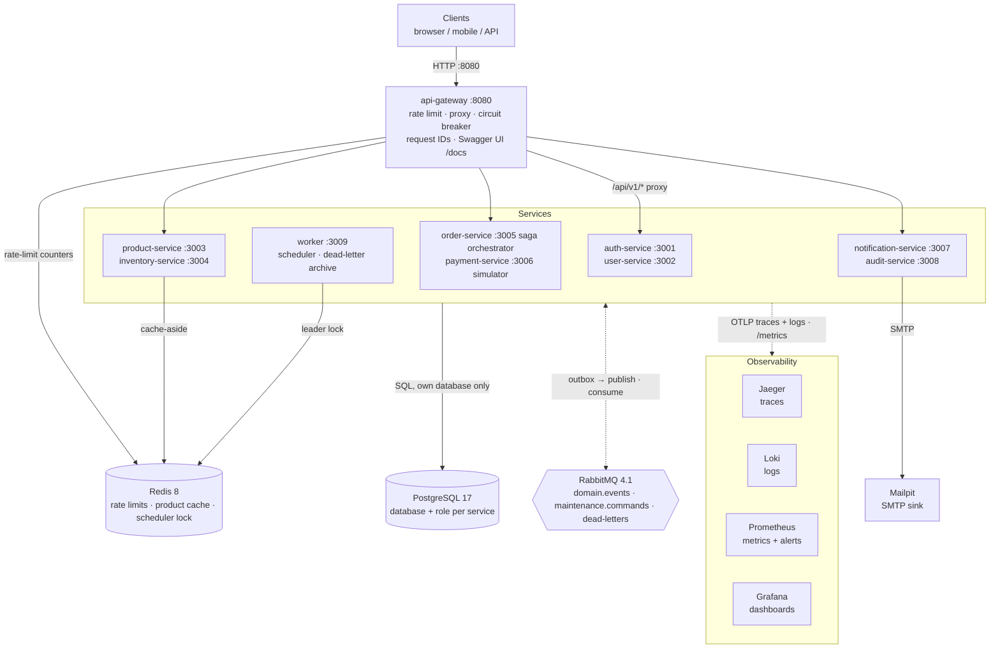

# 1. System overview

[← Architecture index](README.md) · Next: [Request lifecycle →](02-request-lifecycle.md)

The blueprint is eight Express + TypeScript services behind one API gateway, plus a background
worker (services are grouped in pairs below to keep the diagram readable). Each service owns its PostgreSQL database and talks to the others asynchronously through
RabbitMQ; the only synchronous service-to-service calls are order-service's price lookup
(product-service) and payment reconciliation (payment-service), plus every service fetching the
JWKS from auth-service to verify access tokens.

_Static image (no animation) of the same architecture, used as the README hero. The Mermaid
diagram above is the text-based, accessible source of truth._

## Key points

- **Token verification without a call per request.** Every service verifies ES256 access tokens
  locally against auth-service's JWKS (`/.well-known/jwks.json`, cached and refreshed only on an
  unknown `kid`); the edge is omitted above to keep the diagram readable
  ([page 7](07-authentication.md)).
- **One public entry point.** Only `api-gateway` serves the public API. It never routes
  `/internal/*`, `/metrics`, `/health/*` or `/admin/*` paths of the services
  ([`apps/api-gateway/src/routes.ts`](../../apps/api-gateway/src/routes.ts)).
- **Database per service.** Each service connects with its own role to its own database
  (`auth_db`, `users_db`, `product_db`, `inventory_db`, `orders_db`, `payment_db`,
  `notification_db`, `audit_db`, `worker_db`); `PUBLIC CONNECT` is revoked, so no service can read
  another's tables.
- **Asynchronous by default.** Every domain event is written to the service's `outbox_events`
  table in the same transaction as the state change and relayed to RabbitMQ
  ([page 5](05-transactional-outbox.md)). Consumers are idempotent through `processed_messages`.
- **Worker.** Publishes `MaintenanceRequested.v1` commands on a schedule (reservation expiry, saga
  timeouts, payment reconciliation, audit retention, cleanup) and archives dead letters with an
  admin replay API that is only reachable on `127.0.0.1:3009`.
- **Payments are simulated.** `payment-service` is a local simulator; it never handles card data.
