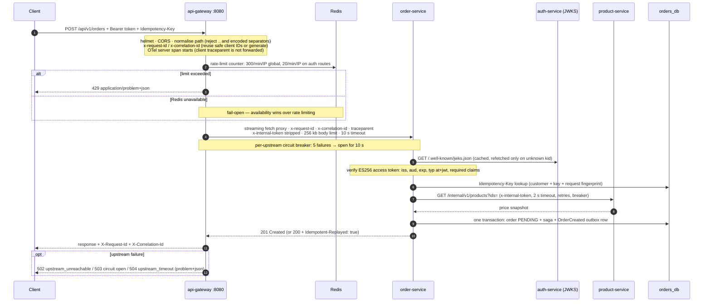

# 2. Request lifecycle

[← System overview](01-system-overview.md) · [Index](README.md) · Next: [RabbitMQ event flow →](03-rabbitmq-event-flow.md)

A public request passes the gateway's edge concerns, is proxied to exactly one upstream service and
runs through the shared middleware chain from `@emb/http-kit`
([`packages/http-kit/src/app.ts`](../../packages/http-kit/src/app.ts)). The example is
`POST /api/v1/orders`.

_Animated preview (CSS animation; it pauses into a static view when your system prefers reduced
motion). The Mermaid diagram above is the static, accessible alternative._

## What happens where

| Concern         | Where                                           | Behaviour                                                                                                                                      |
| --------------- | ----------------------------------------------- | ---------------------------------------------------------------------------------------------------------------------------------------------- |
| Path safety     | gateway `normalizePath`                         | Rejects `..`, `.` and encoded separators (`%2e`, `%2f`, `%5c`) with 400 before matching a route.                                               |
| Routing         | gateway `ROUTES`                                | Whole-segment prefix match; unknown paths → 404. Internal, metrics, health and admin paths are never routed.                                   |
| Rate limiting   | gateway + Redis                                 | `express-rate-limit` with a Redis store; `passOnStoreError` makes it fail open.                                                                |
| Request IDs     | `requestContextMiddleware`                      | Accepts caller IDs matching `^[A-Za-z0-9._:-]{1,128}$`, otherwise generates a UUID; echoed as response headers and attached to every log line. |
| Tracing         | OTel http/express/undici instrumentation        | The gateway strips inbound `traceparent`/`tracestate`; the fetch instrumentation injects the gateway's own context into the upstream call.     |
| Timeouts        | gateway `UpstreamProxy`                         | 10 s per upstream call; no automatic retries at the edge (non-idempotent requests must never be replayed by infrastructure).                   |
| Circuit breaker | gateway (per upstream) and service HTTP clients | Upstream 502/503/504 responses count as failures but are still relayed.                                                                        |
| Authentication  | each service (`@emb/security`)                  | Local JWT verification against the JWKS; a JWKS outage fails closed with 503.                                                                  |
| Errors          | `errorHandler`                                  | Every error is an RFC 9457 `application/problem+json` document; 5xx details are not exposed.                                                   |
