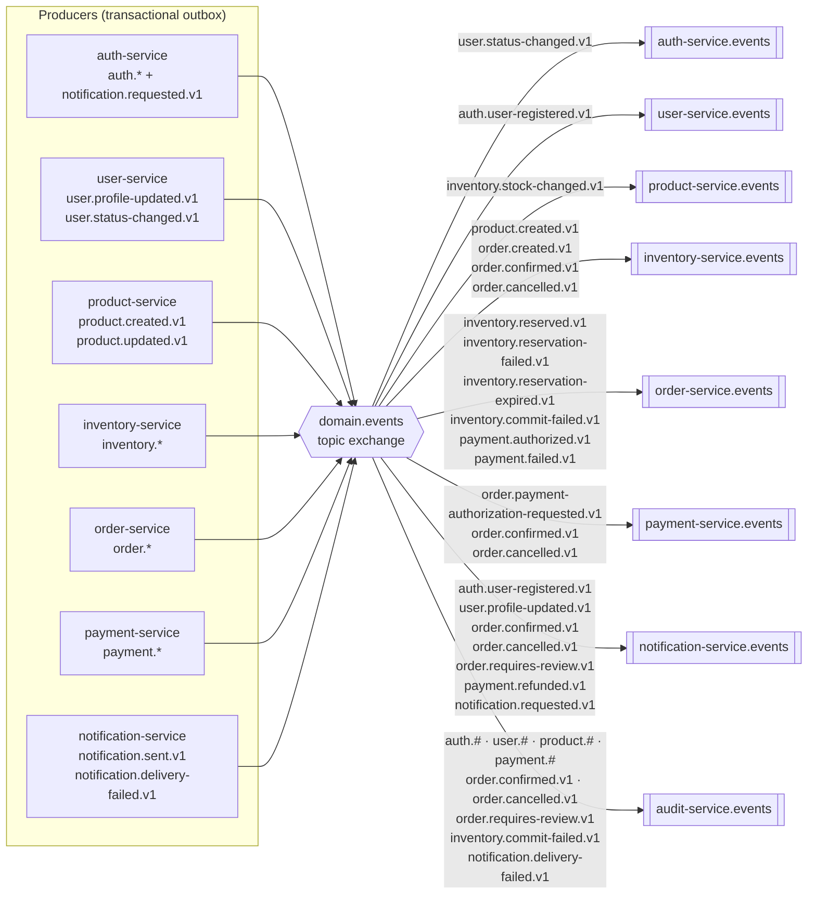
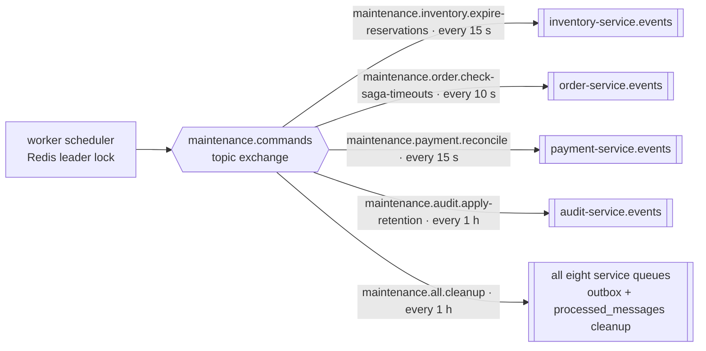
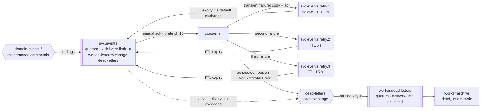

# 3. RabbitMQ event flow

[← Request lifecycle](02-request-lifecycle.md) · [Index](README.md) · Next: [Order saga →](04-order-saga.md)

All topology is declared in one place,
[`packages/contracts/src/topology.ts`](../../packages/contracts/src/topology.ts), with routing keys
from [`packages/contracts/src/events.ts`](../../packages/contracts/src/events.ts) and
[`maintenance.ts`](../../packages/contracts/src/maintenance.ts). The migrator declares it before
any service starts; `infrastructure/rabbitmq/definitions.json` is an import-ready copy generated by
`npm run topology:generate`.

There are three durable **topic** exchanges:

| Exchange               | Published by                                                         | Purpose                                                              |
| ---------------------- | -------------------------------------------------------------------- | -------------------------------------------------------------------- |
| `domain.events`        | every service's outbox relay                                         | Domain events, routing key `<domain>.<event>.v1`                     |
| `maintenance.commands` | worker scheduler                                                     | `MaintenanceRequested.v1` commands, routing key `maintenance.<task>` |
| `dead-letters`         | consumers (explicit) and RabbitMQ (native, after the delivery limit) | Messages that cannot be processed                                    |

## Event routing (domain.events)

Each service consumes from exactly one quorum queue, `<service>.events`. Edge labels are the real
binding keys.

`inventory.released.v1`, `inventory.committed.v1` and `notification.sent.v1` are published for
completeness but currently have no binding; adding a consumer is a matter of adding a binding in
`topology.ts`.

### Producer routing keys

| Producer             | Routing keys                                                                                                                                                                                                                                |
| -------------------- | ------------------------------------------------------------------------------------------------------------------------------------------------------------------------------------------------------------------------------------------- |
| auth-service         | `auth.user-registered.v1`, `auth.user-logged-in.v1`, `auth.user-logged-out.v1`, `auth.login-failed.v1`, `auth.refresh-token-reuse-detected.v1`, `auth.password-reset-requested.v1`, `auth.password-changed.v1`, `notification.requested.v1` |
| user-service         | `user.profile-updated.v1`, `user.status-changed.v1`                                                                                                                                                                                         |
| product-service      | `product.created.v1`, `product.updated.v1`                                                                                                                                                                                                  |
| inventory-service    | `inventory.reserved.v1`, `inventory.reservation-failed.v1`, `inventory.released.v1`, `inventory.reservation-expired.v1`, `inventory.committed.v1`, `inventory.commit-failed.v1`, `inventory.stock-changed.v1`                               |
| order-service        | `order.created.v1`, `order.payment-authorization-requested.v1`, `order.confirmed.v1`, `order.cancelled.v1`, `order.requires-review.v1`                                                                                                      |
| payment-service      | `payment.authorized.v1`, `payment.failed.v1`, `payment.captured.v1`, `payment.voided.v1`, `payment.refunded.v1`                                                                                                                             |
| notification-service | `notification.sent.v1`, `notification.delivery-failed.v1`                                                                                                                                                                                   |

## Maintenance commands (maintenance.commands)

The worker publishes `MaintenanceRequested.v1` on a fixed interval, guarded by a Redis
`SET NX PX` lock so only one worker replica schedules (fail-open when Redis is down). The owning
service performs the work against its own database.

## Queue anatomy: retries and dead letters

Every service queue has the same shape (see [page 6](06-retry-dead-letter.md) for the message
path).

- notification-service backs off longer: `retry.1..3` TTLs are **2 s / 10 s / 30 s**.
- `worker.dead-letters` has no DLX of its own and requeues on failure, so the archive never loses
  a message.
- Messages are persistent, published with publisher confirms (5 s timeout), and carry the
  envelope (`id`, `type`, `version`, `occurredAt`, `producer`, `correlationId`, `causationId`,
  `subject`, `payload`) plus W3C `traceparent` headers. Envelope and payload are validated with
  zod on both ends.
