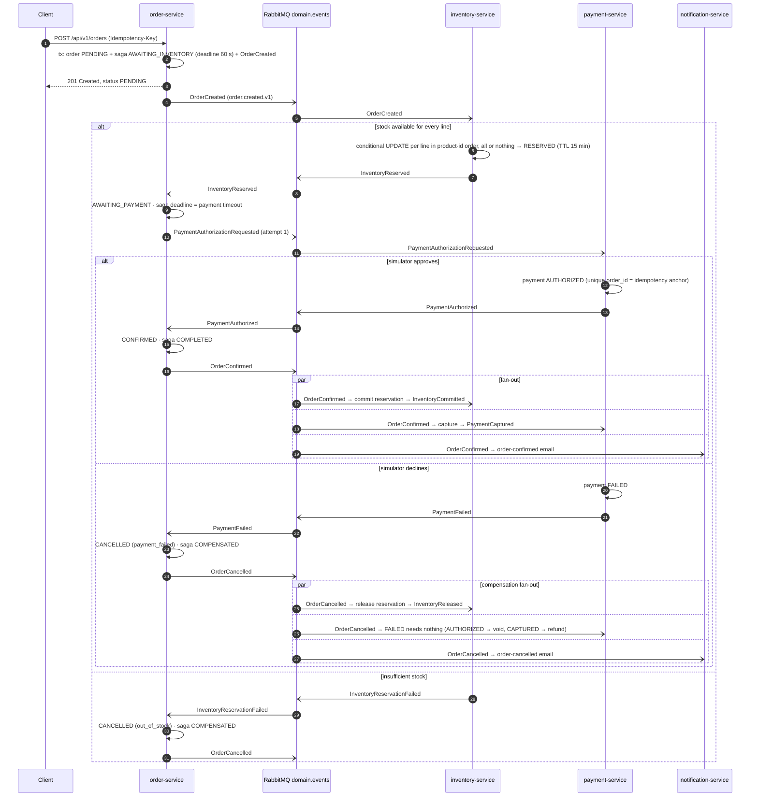
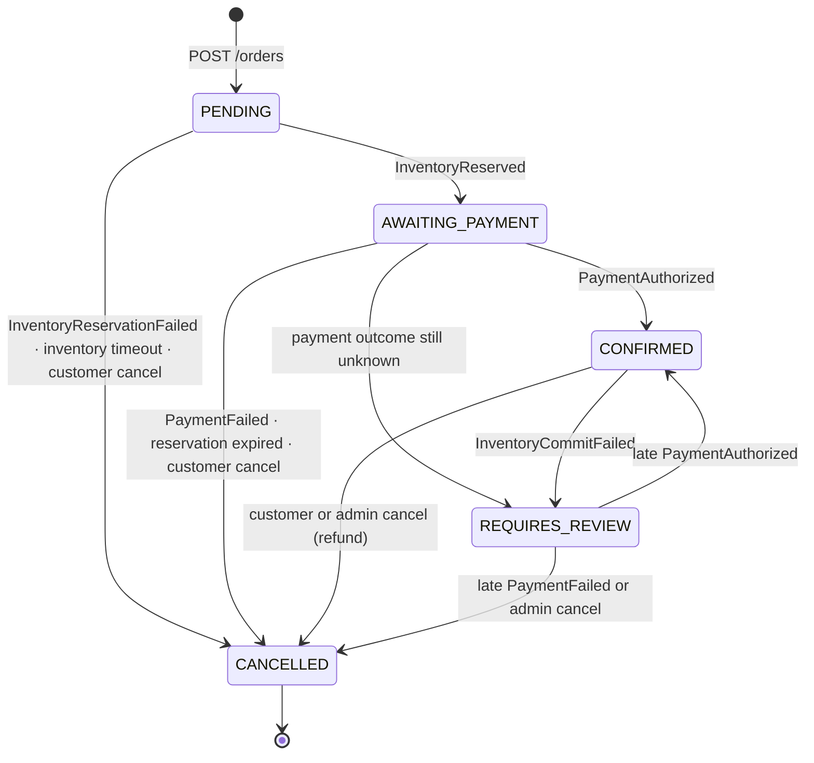
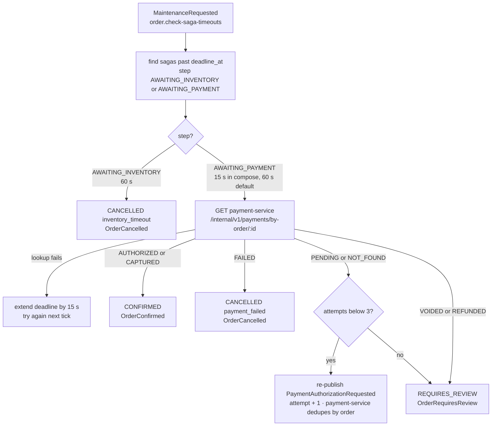

# 4. Order-processing saga

[← RabbitMQ event flow](03-rabbitmq-event-flow.md) · [Index](README.md) · Next: [Transactional outbox →](05-transactional-outbox.md)

order-service is the **orchestrator**
([`apps/order-service/src/domain/order-saga.ts`](../../apps/order-service/src/domain/order-saga.ts)).
It keeps the workflow state in `order_sagas` (step + deadline), reacts to participant events and
issues the next command or compensation through its outbox. Every handler records the message ID,
locks the order row, applies the transition only if the state machine allows it and writes
follow-up events in the same transaction — so duplicates and out-of-order events are harmless, and
a restarted process resumes where it left off.

<table>
<tr>
<td width="50%">

</td>
<td width="50%">

</td>
</tr>
</table>

_Animated previews (CSS animation) of the happy path and the payment-declined compensation path.
They pause into a static view when your system prefers reduced motion; the Mermaid diagrams on
this page are the static, accessible alternative._

## Order and saga states

Saga steps (`order_sagas.step`): `AWAITING_INVENTORY` → `AWAITING_PAYMENT` → `COMPLETED`, or
`COMPENSATED` (cancelled) / `REQUIRES_REVIEW`. Every `CANCELLED` transition emits `OrderCancelled`,
which drives the compensations; inventory and payment both keep **tombstones** when a cancel
arrives before the reservation or payment exists, so a late request is ignored instead of
re-reserving stock or charging the card.

## Timeouts and reconciliation

The worker publishes `maintenance.order.check-saga-timeouts` every 10 s. order-service then
handles overdue sagas — network calls happen outside any transaction and the decision is applied
under the row lock after re-checking the state.

Other time-based guards: inventory expires `RESERVED` reservations after 15 minutes
(`maintenance.inventory.expire-reservations`, publishing `InventoryReservationExpired`, which
cancels the order with `reservation_expired`), and payment-service resolves payments stuck in
`PROCESSING` for more than 20 s by asking the simulator (`maintenance.payment.reconcile`).
