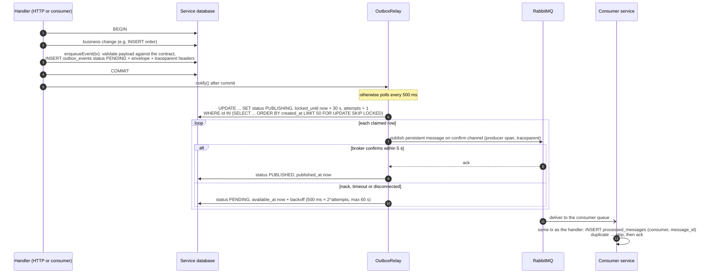
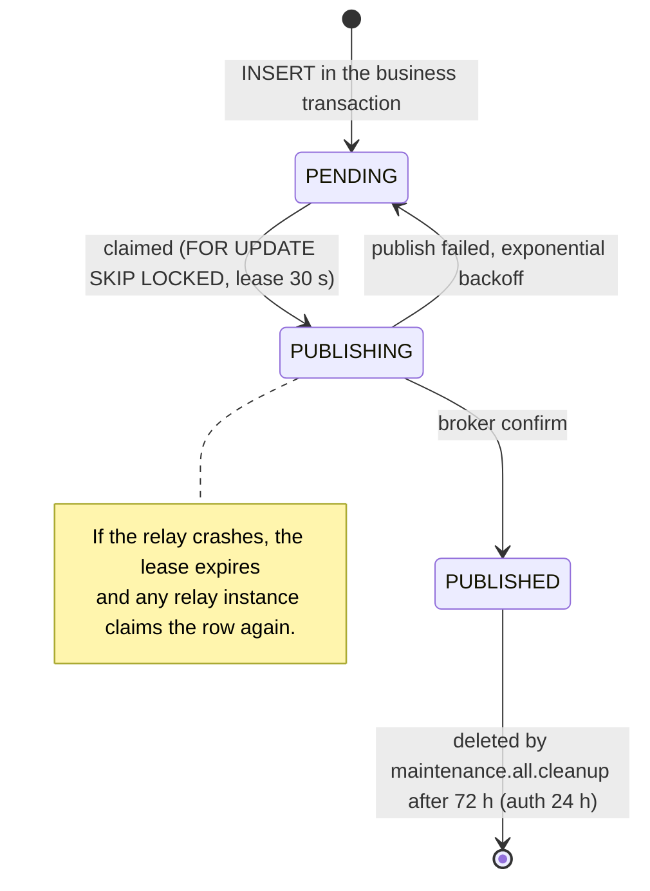

# 5. Transactional outbox

[← Order saga](04-order-saga.md) · [Index](README.md) · Next: [Retry and dead-letter flow →](06-retry-dead-letter.md)

No service publishes to RabbitMQ from a request handler. Events are inserted into the service's
own `outbox_events` table **in the same transaction** as the state change
([`packages/database/src/outbox.ts`](../../packages/database/src/outbox.ts)) and published later by
the `OutboxRelay` running in the same process
([`packages/messaging/src/outbox-relay.ts`](../../packages/messaging/src/outbox-relay.ts)). The
state change and the event therefore commit together or not at all, and a broker outage never
fails a request (see [page 12](12-failure-recovery.md)).

_Animated preview (CSS animation). The Mermaid diagrams on this page are the static, accessible
alternative._

## Outbox row lifecycle

## Guarantees and trade-offs

- **At-least-once publication.** A crash between the broker confirm and `PUBLISHED` re-publishes
  the row after the lease expires. Consumers are idempotent by envelope ID (`processed_messages`
  inserted inside the handler's transaction), so the duplicate is a no-op.
- **Never dropped.** Failed publishes go back to `PENDING` with backoff; there is no maximum
  attempt count. `outbox_pending_events` and `outbox_oldest_pending_age_seconds` feed the
  `OutboxPublishingStalled` alert.
- **Safe with replicas.** `FOR UPDATE SKIP LOCKED` lets several relay instances run concurrently
  without blocking or double-claiming.
- **Ordering.** Rows are claimed in `created_at` order, but retries can reorder events; handlers
  rely on the state machine and `occurredAt` guards rather than delivery order.
- **Traceable.** The trace context captured at write time is stored with the row, so the relay's
  producer span and the consumer span join the originating request's trace
  ([page 8](08-observability.md)).
