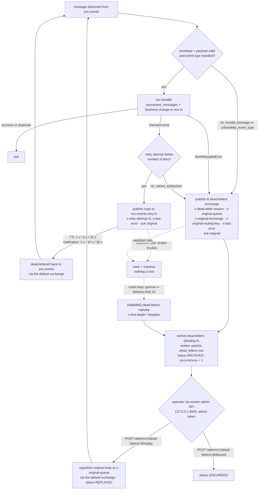

# 6. Retry and dead-letter flow

[← Transactional outbox](05-transactional-outbox.md) · [Index](README.md) · Next: [Authentication →](07-authentication.md)

Consumers use manual acknowledgements and route every failure explicitly
([`packages/messaging/src/consumer.ts`](../../packages/messaging/src/consumer.ts)). A message is
acked only after its outcome has been durably handed off — to a retry queue, the dead-letter
exchange, or the handler's committed transaction — so failures are never silently swallowed.

_Animated preview (CSS animation). The Mermaid diagram above is the static, accessible
alternative._

## Notes

- **Retry tiers** are classic queues with a per-queue `x-message-ttl` and
  `x-dead-letter-exchange: ""` / `x-dead-letter-routing-key: <queue>`, so an expired message returns
  to its own main queue only — other consumers bound to the same event never see the retry.
- **Poison messages** (malformed envelope, schema mismatch, unknown event type) and
  `NonRetryableError` skip the tiers and are dead-lettered on the first delivery.
- **Delivery limit.** Main queues are quorum queues with `x-delivery-limit: 10` and
  `x-dead-letter-exchange: dead-letters`, the safety net for messages that crash the process before
  ack or nack.
- **The archive cannot lose messages.** `worker.dead-letters` uses an unlimited delivery limit and
  no DLX, consumes in raw mode (it must accept malformed messages) and requeues on failure.
- **Replay targets one consumer.** A replay goes to the original queue through the default
  exchange, not back through `domain.events`, so only the consumer that failed sees it again; it is
  idempotent by envelope ID.
- **Signals.** `messaging_retries_total`, `messaging_dead_lettered_total`,
  `dead_letters_archived_total` and `dead_letters_open` drive the `MessagesDeadLettered` and
  `RepeatedDeadLetters` alerts (runbook: `docs/operations/runbook.md#dead-letters`).
