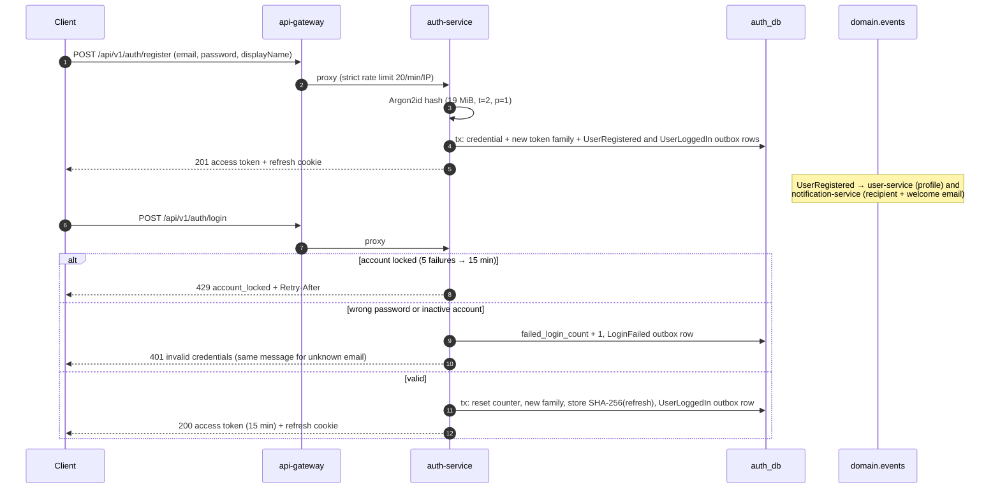
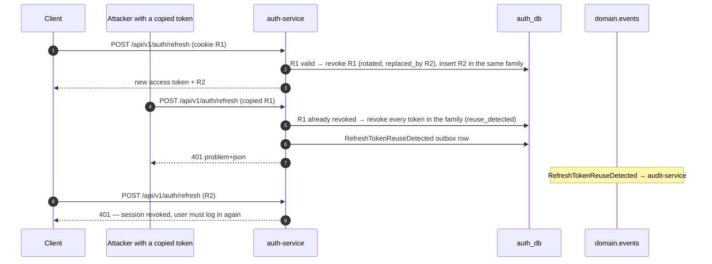
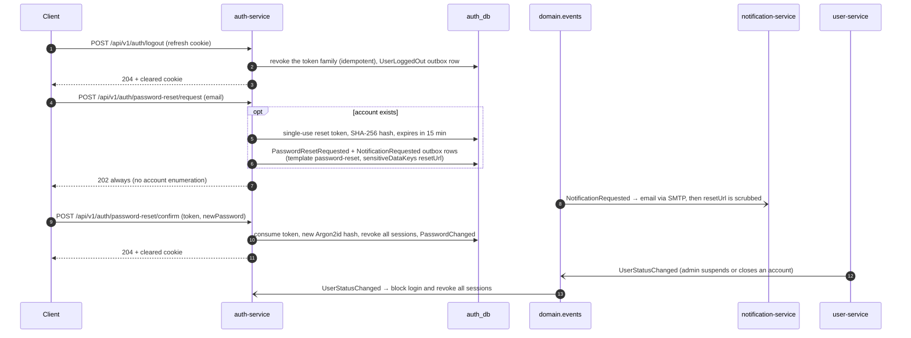
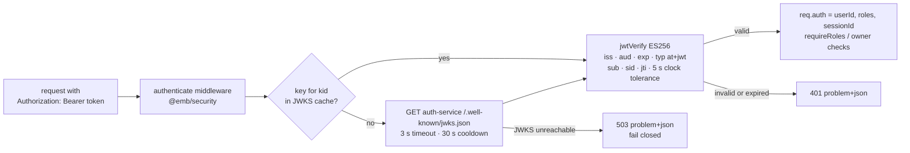

# 7. Authentication flow

[← Retry and dead-letter flow](06-retry-dead-letter.md) · [Index](README.md) · Next: [Observability →](08-observability.md)

auth-service ([`apps/auth-service`](../../apps/auth-service)) issues short-lived **ES256 access
tokens** (15 min, `typ: at+jwt`, `iss: emb-auth-service`, `aud: emb-api`, claims `sub`, `roles`,
`sid`, `jti`) and opaque **256-bit refresh tokens** stored only as SHA-256 hashes. The refresh
token travels in an `HttpOnly`, `SameSite=Strict` cookie `emb_refresh_token` scoped to
`/api/v1/auth` (and in the response body for non-browser clients). The gateway applies the strict
rate limit (20/min/IP) to login, register, refresh and password-reset routes.

## Register and login

## Refresh-token rotation with reuse detection

_Animated preview (CSS animation). The Mermaid diagrams on this page are the static, accessible
alternative._

## Logout, password reset and account status

## How services verify tokens (JWKS)

No service calls auth-service per request. `@emb/security` verifies each bearer token locally
against the JWKS published by auth-service.

Service-to-service calls (`/internal/*`) do not use JWTs: they require the shared
`x-internal-token` header, which the gateway strips from every inbound request.
