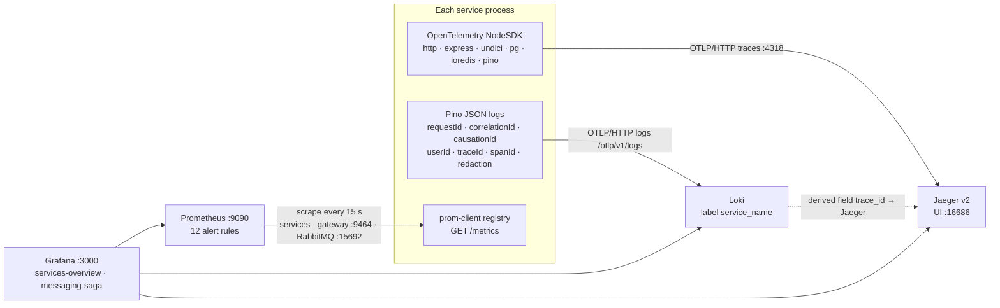
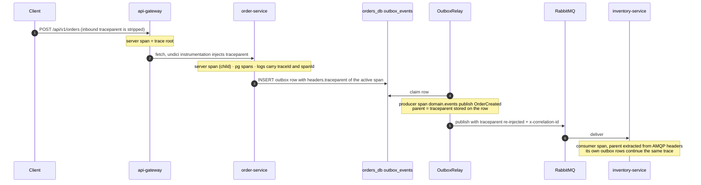

# 8. Observability and tracing

[← Authentication](07-authentication.md) · [Index](README.md) · Next: [Docker Compose deployment →](09-docker-compose.md)

Every Node process preloads the OpenTelemetry NodeSDK with `node --import` (plus the ESM loader
hook) from [`packages/observability`](../../packages/observability). Instrumentations: `http`,
`express`, `undici` (fetch), `pg`, `ioredis` and `pino` (log export). Exporter endpoints use the
standard `OTEL_EXPORTER_OTLP_*` variables.

## Trace context end to end

One order produces a single trace across HTTP, the outbox and RabbitMQ: the trace context is
stored in the outbox row's `headers` column at write time and travels as W3C `traceparent` /
`tracestate` AMQP headers.

## Signals at a glance

| Signal      | Where it goes                                                                 | Examples                                                                                                                                            |
| ----------- | ----------------------------------------------------------------------------- | --------------------------------------------------------------------------------------------------------------------------------------------------- |
| Traces      | Jaeger (OTLP 4318)                                                            | HTTP server/client spans, `pg`, `ioredis`, outbox producer and consumer spans                                                                       |
| Logs        | Loki (OTLP), stdout JSON                                                      | Correlated by `traceId`, `requestId`, `correlationId` (the order ID for saga events)                                                                |
| RED metrics | Prometheus                                                                    | `http_requests_total`, `http_request_duration_seconds`, `http_requests_in_flight`                                                                   |
| Messaging   | Prometheus                                                                    | `messaging_messages_consumed_total`, `messaging_retries_total`, `messaging_dead_lettered_total`, `messaging_connection_up`, `outbox_pending_events` |
| Saga        | Prometheus                                                                    | `saga_completed_total`, `saga_duration_seconds`, `saga_step_timeouts_total`                                                                         |
| Alerts      | Prometheus rules ([`alerts.yml`](../../infrastructure/prometheus/alerts.yml)) | `ServiceDown`, `OutboxPublishingStalled`, `BrokerConnectionLost`, `MessagesDeadLettered`, `SagaFailureRateHigh`, … each linking a runbook anchor    |

Sampling is `parentbased_traceidratio` (1.0 in Compose). The gateway serves metrics on an internal
port (9464) so `/metrics` is never reachable through the public API.
