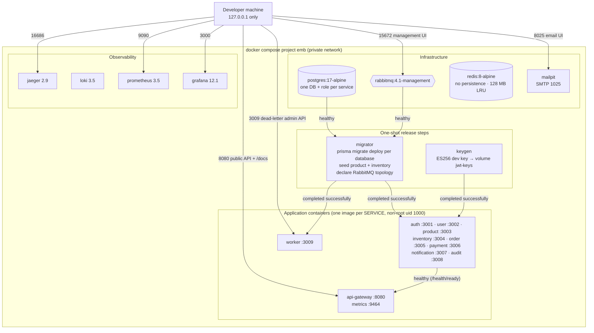
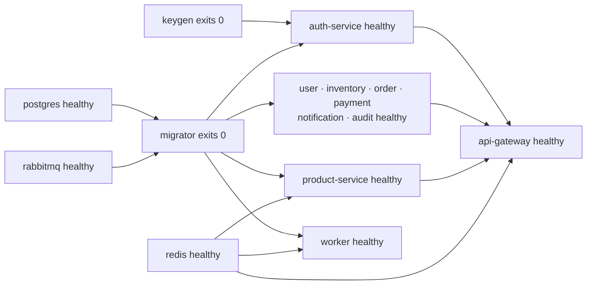

# 9. Docker Compose deployment

[← Observability](08-observability.md) · [Index](README.md) · Next: [Kubernetes (optional) →](10-kubernetes.md)

`docker compose up --build` (project name `emb`, [`docker-compose.yml`](../../docker-compose.yml))
starts the complete environment on one private bridge network. Only the ports below are
published, and every one binds to **127.0.0.1**; PostgreSQL, RabbitMQ AMQP and Redis are not
published at all.

## Volumes

| Volume            | Mounted by                                  | Contents                                                                           |
| ----------------- | ------------------------------------------- | ---------------------------------------------------------------------------------- |
| `postgres-data`   | postgres                                    | All service databases                                                              |
| `rabbitmq-data`   | rabbitmq                                    | Quorum queue data, definitions                                                     |
| `jwt-keys`        | keygen (rw), auth-service (ro, `/run/keys`) | Development ES256 signing key                                                      |
| `loki-data`       | loki                                        | Log chunks                                                                         |
| `prometheus-data` | prometheus                                  | TSDB (3-day retention)                                                             |
| `grafana-data`    | grafana                                     | Grafana state (dashboards are provisioned read-only from `infrastructure/grafana`) |

## Startup order

- Every service and the worker depend on `migrator` (completed successfully), `postgres` and
  `rabbitmq` (healthy); product-service and the worker also wait for Redis, auth-service for
  `keygen`, and notification-service for Mailpit. The gateway starts once Redis and all eight
  services are healthy.
- Health checks call `/health/ready`, which returns 503 while PostgreSQL or RabbitMQ (critical
  checks) are unavailable; Redis is a non-critical check (status `degraded`) for product-service
  and the gateway.
- Containers run with `init: true`, `restart: unless-stopped`, a 20 s stop grace period for
  graceful shutdown, memory limits (256M per service, 384M for auth-service) and size-capped
  JSON logs.
- Images come from one multi-stage Dockerfile,
  [`infrastructure/docker/node-service.Dockerfile`](../../infrastructure/docker/node-service.Dockerfile)
  (`runtime` target per `SERVICE` build-arg, plus the `migrator` target).
