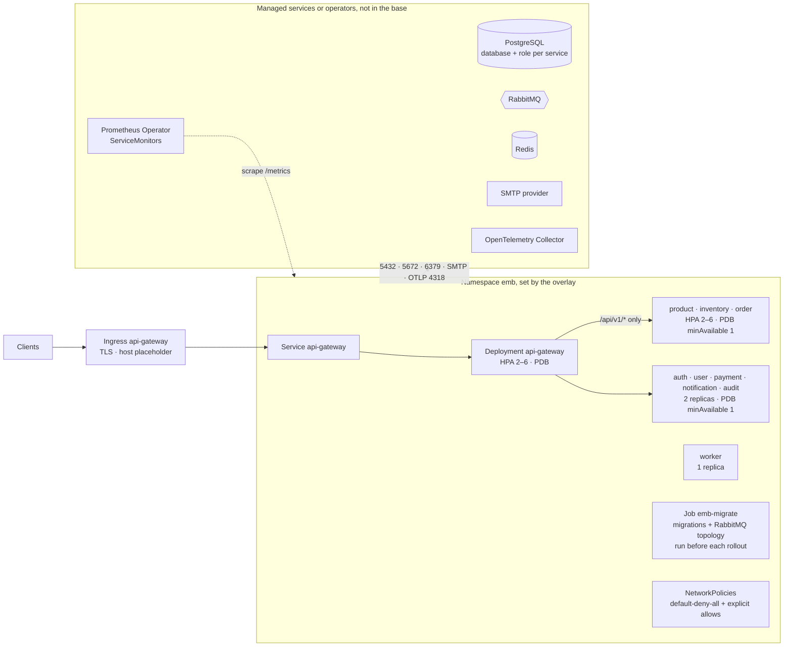

# 10. Kubernetes architecture (optional)

[← Docker Compose deployment](09-docker-compose.md) · [Index](README.md) · Next: [CI/CD pipeline →](11-ci-cd.md)

> **Optional.** Docker Compose is the primary way to run this project. The Kustomize manifests in
> [`infrastructure/kubernetes`](../../infrastructure/kubernetes) are a starting point for a cluster
> deployment, not a turnkey platform: they ship no Secrets, no namespace in the base, and **no
> PostgreSQL, RabbitMQ or Redis** — use managed services or operators.

## What the manifests enforce

- **Only the gateway is exposed.** The Ingress targets the `api-gateway` Service; every other
  Service is `ClusterIP`. Internal routes (`/internal/*`, `/metrics`, `/health/*`, `/admin/*`) stay
  unreachable from outside.
- **Zero-trust networking.** `default-deny-all` plus allow rules for exactly the flows the code
  uses: DNS, PostgreSQL, RabbitMQ, Redis, OTLP, SMTP egress; JWKS calls to auth-service;
  order-service to product-service and payment-service; gateway to the services; ingress only from
  namespaces labelled `network.emb/ingress-controller=true` (gateway) and
  `network.emb/monitoring=true` (metrics). Requires a CNI that enforces NetworkPolicy.
- **Safe rollouts.** Rolling updates with `maxUnavailable: 0`, PodDisruptionBudgets
  (`minAvailable: 1`) for the HTTP services, readiness on `/health/ready`, and HPAs for the
  gateway, product, inventory and order services (2–6 replicas).
- **Migrations first.** `Job emb-migrate` uses the `migrator` image target to apply each
  service's migrations and declare the topology; run it and wait for completion before rolling out
  new versions (migrations stay backward compatible, expand/contract).
- **Overlays.** `overlays/local` (kind / minikube: one replica each, no HPA/PDB, OTel disabled) and
  `overlays/production-example` (registry images pinned by tag or digest, managed data services,
  ServiceMonitors). See `secrets.example.yaml` for the Secret names the base expects.
