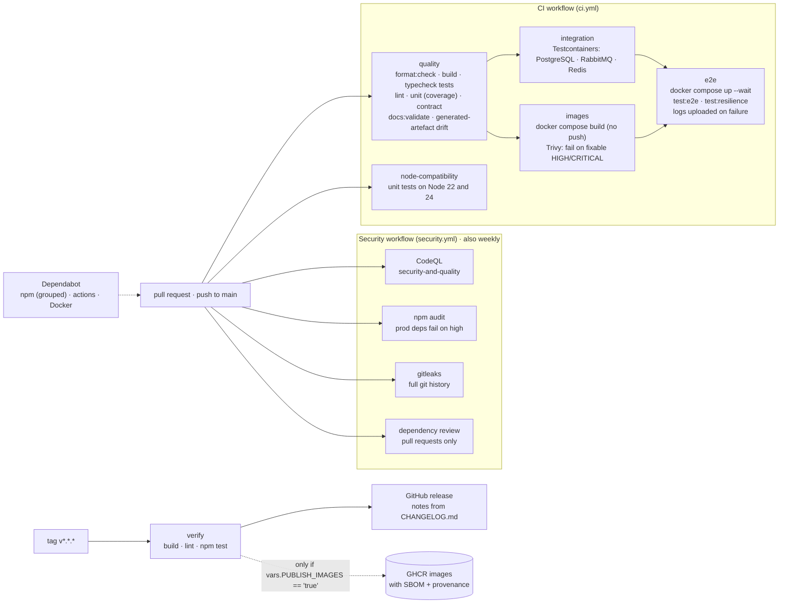

# 11. CI/CD pipeline

[← Kubernetes (optional)](10-kubernetes.md) · [Index](README.md) · Next: [Failure recovery →](12-failure-recovery.md)

The GitHub Actions workflows are in [`.github/workflows`](../../.github/workflows). There are three
of them, plus Dependabot. All use least-privilege `permissions` and pin third-party actions to
commit SHAs.

## Notes

- **Cheap checks run first.** The `quality` job (formatting, compilation, lint, unit and contract
  tests, documentation and OpenAPI validation) must pass before any job starts containers. It also
  regenerates the RabbitMQ definitions, the Grafana dashboards and the animated SVGs, and fails if
  they differ from the committed files.
- **Integration tests** start real PostgreSQL, RabbitMQ and Redis containers with Testcontainers,
  so the outbox, the consumers and the SQL run against the same engines as production.
- **Images** are built from the single multi-stage Dockerfile and scanned with Trivy. Each image is
  scanned on its own, and the job fails on fixable HIGH or CRITICAL findings. Nothing is pushed
  from CI.
- **End-to-end and resilience** tests run the whole stack with Docker Compose. The resilience tests
  stop and start containers. The runner is torn down with `--volumes` afterwards because it is
  ephemeral.
- **Releases** run on semantic-version tags. Release notes come from the matching `CHANGELOG.md`
  section. Images go to GHCR only when the repository variable `PUBLISH_IMAGES` is `true`. Nothing is
  ever deployed automatically.

_Keep this page in sync with the workflow files. If a job is renamed or reordered in
`.github/workflows`, update the diagram._
