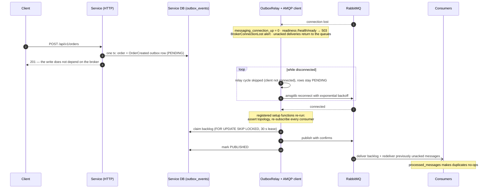
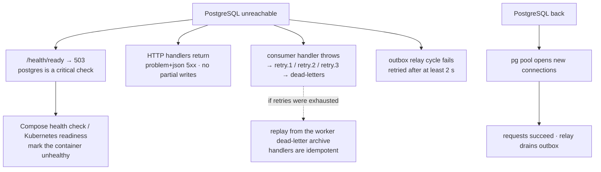
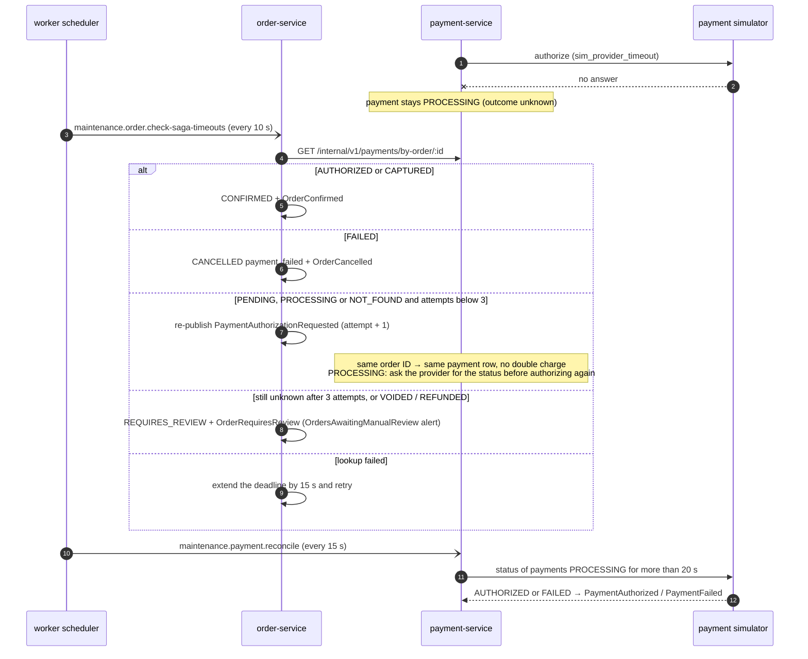
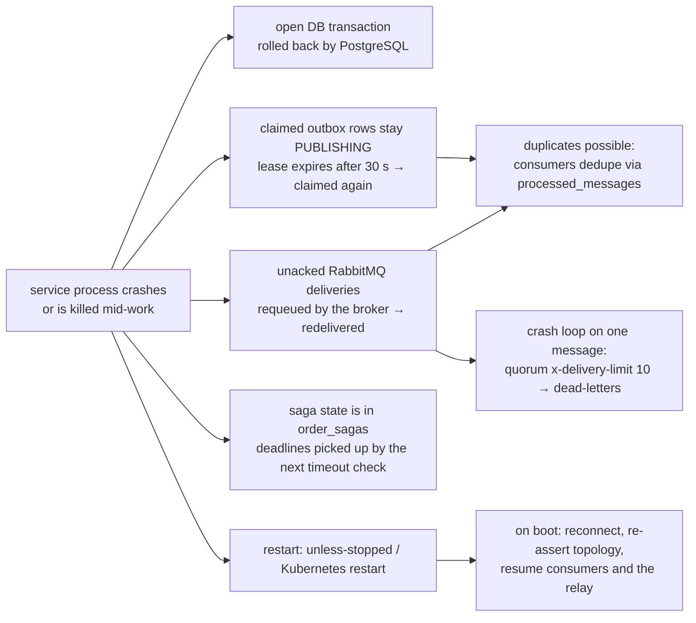

# 12. Failure recovery

[← CI/CD pipeline](11-ci-cd.md) · [Index](README.md)

The system is designed so that every failure either heals automatically or ends in a durable,
visible state (an outbox row, a dead letter, an order in `REQUIRES_REVIEW`) — never in a silently
lost message. Operational procedures live in the runbook (`docs/operations/runbook.md`).

## Broker outage

_Animated preview (CSS animation). The Mermaid diagrams on this page are the static, accessible
alternative._

In Docker Compose the gateway keeps routing to a service whose readiness is 503, so writes keep
landing in the outbox. In Kubernetes the same 503 removes the pod from its Service endpoints until
the broker is back, which turns a broker outage into fast `503`s at the edge instead of stuck
requests.

## Database outage

## Payment timeout and reconciliation

A timeout is never treated as a failure; the orchestrator asks payment-service for the real
outcome first.

## Process crash

Graceful shutdown (SIGTERM; 15 s internal deadline inside the 20 s Compose grace period) first
reports not-ready, stops accepting HTTP connections, then runs the shutdown hooks in reverse order
— consumers drain in-flight handlers, the relay stops, connections close. Anything still unacked
after the consumer drain timeout is redelivered by the broker.
